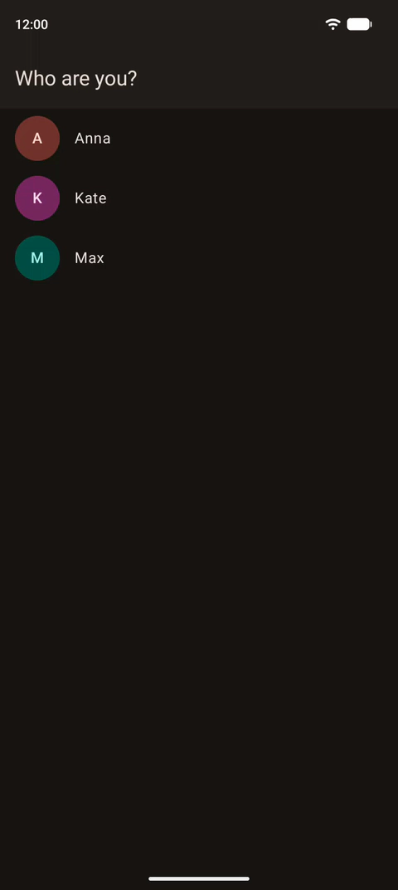

# ChatApp

[](https://github.com/dmitriiecho/ChatApp/actions/workflows/ci.yml)

[English version](README.md)

> [!WARNING]
> **Проект в работе.** Приложение ещё в разработке: `main` — не финальная версия, от коммита к коммиту многое меняется, а некоторые части могут быть недоделаны.

ChatApp — пример чата для Android на современном стеке, со своим сервером. Вы выбираете, под каким пользователем войти, и получаете список чатов: с двумя другими людьми, группу и пару сотен ботов, которые пишут сами и отвечают вам.

&nbsp;

## Как это выглядит

Вход под пользователем Max, прокрутка списка чатов, чат с ботом, сообщение ему и его ответ:

<p>
  
</p>

&nbsp;

## Что внутри

Приложение небольшое, но в нём есть почти всё, что нужно настоящему мессенджеру:

- **Работа без сети**: экраны читают только кэш в Room. Чат, который вы уже открывали, откроется и без сети, а новые сообщения придут, когда она появится.
- **Обновления в реальном времени** по WebSocket: новые сообщения, правки и удаления, подъём чатов наверх списка, прочтение на другом устройстве.
- **Досинхронизация после перерыва**: когда приложение было в фоне или без сети, оно запрашивает у сервера только то, что изменилось за это время.
- **Отправка через outbox**: сообщение появляется в чате сразу, а WorkManager отправляет его, когда есть сеть: по порядку, без дублей, даже после закрытия приложения.
- **Длинные чаты и длинные списки**: экраны показывают окно в кэше, которое подгружает страницы вверх и вниз, открывается на первом непрочитанном сообщении и никогда не держит больше нескольких сотен элементов. Чтобы это попробовать, в тулбаре чата есть кнопка прыжка на случайное сообщение из истории.
- **Отметки прочтения**: разделитель «Новые сообщения» и счётчики непрочитанных, одинаковые на всех устройствах пользователя.
- **Боты**, которые пишут каждые 10–30 секунд, и переключатель под списком чатов, который выключает их для всех.
- **Светлая и тёмная тема**, переключатель — в списке чатов.

&nbsp;

## Архитектура

Модули разложены по четырём уровням, и сборка проверяет, что ни один модуль не зависит от уровня выше своего:

```text
app/           app                                приложение
feature/       login, chats                       по одной фиче в каждом
crossfeature/  domain, data, ui                   код про чаты, нужный двум и более фичам
core/          designsystem, compose-utils,       ничего не знает про чаты
               mvi, network
```

Экраны построены на MVI с небольшим собственным ядром, DI — Koin с компиляторным плагином, навигация — Navigation 3. Как устроены модули, навигация, экраны, данные, синхронизация и сборка, рассказано в [документации по архитектуре](docs/architecture/ru/README.md).

&nbsp;

## Тесты и CI

- **Тесты** запускаются на JVM и покрывают ядро MVI, логику экранов, слой данных с синхронизацией, контракт с сервером и скриншоты всех превью.
- **CI** запускается на каждый pull request: стиль кода, правила модулей, неиспользуемые зависимости, lint, тесты и сборка приложения, которая заодно проверяет граф Koin.

&nbsp;

## Запуск

Проще всего скачать [APK из `main`](https://github.com/dmitriiecho/ChatApp/releases/download/main-latest/ChatApp.apk). Это release-сборка для Android 8.0 и новее, CI пересобирает её после каждого изменения кода в `main`.

Чтобы собрать приложение самому, нужны JDK 21, Android SDK и ключ сервера:

```properties
# local.properties
chatapp.apiKey=<ключ>
```

```sh
./gradlew :app:installDebug   # ставит приложение на подключённое устройство
```

Без ключа приложение собирается и запускается, но сервер отвечает 401, и экран входа показывает ошибку.

&nbsp;

## Сервер

Чаты, сообщения и события отдаёт сервер на Ktor с SQLite, он лежит в [`server/`](server/README.ru.md). Сервер развёрнут по адресу `http://2.56.204.151:8081/`, с ним работают и debug-, и release-сборки.

&nbsp;

## Сделано с AI-агентами

Приложение сделано с AI-агентами Claude Code, Cursor и Grok Build, на моделях Claude Opus и Grok. Агенты сильно ускоряют работу, но сами по себе хороший код не пишут: им нужны правила, пошаговые указания и человек, который проверит результат. Вот как это устроено в проекте:

- **Правила для агентов записаны**: [CLAUDE.md](CLAUDE.md) описывает устройство модулей, стиль кода и соглашения для экранов и данных.
- **Изменения делаются маленькими шагами**, и каждый обсуждается и проверяется, прежде чем попасть в коммит.
- **Поведение проверяют тесты и CI** (см. [выше](#тесты-и-ci)), а каждое изменение ещё и проверяется вручную на эмуляторе.
